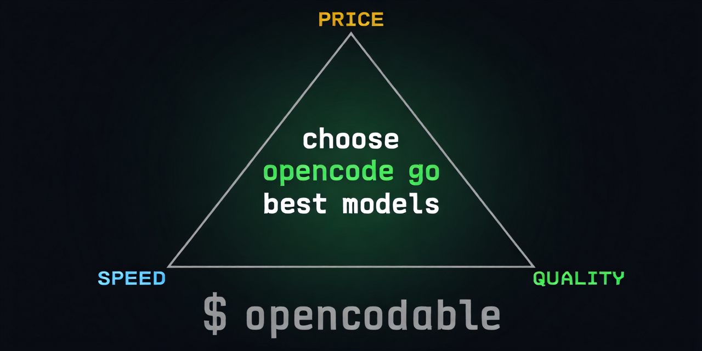

# opencodable



**Find the best compromise of price, speed and quality among the models of your
OpenCode subscription — right now, in your terminal.**

[MIT licensed](LICENSE) · [releases](https://github.com/ColasNahaboo/opencodable/releases) · single Go binary · zero dependencies · Go 1.26+

---

## Overview

`opencodable` is a single Go binary (standard library only, zero dependencies)
that joins four data sources — your subscription's catalog, OpenCode's own plan
data, Artificial Analysis benchmarks, and live measurements of *your* endpoints.

It outputs a simple text table on the terminal, but is designed to be scripted either by its JSON output or unix tab-separated lines if its output is piped into a program. Basically it gathers data so that you can present it as you like.

## The problem

Choosing a model inside a subscription like OpenCode Go is confusing:

- **Retail prices mislead.** The subscription bills through *per-model monthly
  allowances* (e.g. $15/month for GLM-5.3, $60/month for GLM-5.3-Flash), not
  token prices — so the "cheapest" model is not the one that gives you the most
  usable work.
- **Consumption differs wildly.** Reasoning models burn far more tokens per
  request than flash models; list prices per 1M tokens do not translate into
  requests you can actually make.
- **Benchmark sites compare the wrong set.** Public leaderboards (Artificial
  Analysis, BenchLM, Vellum…) rank the whole market, not the ~40 models your
  subscription exposes, and their speed numbers reflect *their* hosts, not your
  provider's routing.
- **No CLI exists for this.** Everything is a website; nothing outputs plain,
  scriptable text about *your* plan.

## The solution

One command joins everything into a decision table:

1. **Catalog & prices** — `models.dev` `api.json` (the source OpenCode itself
   uses): retail $/1M input/output/cached prices, context limits, reasoning flags.
2. **Subscription reality** — OpenCode's public Go/Go Plus tables, snapshotted
   in `internal/goplan`: per-model monthly allowances, OpenCode's own
   estimated token consumption per coding-agent request, peak-hour price
   overrides, and privacy flags (which models train on your prompts).
3. **Quality & reported speed** — Artificial Analysis data API (free key):
   intelligence/coding/math indexes, LiveCodeBench, Terminal-Bench, IFBench,
   long-context reasoning, plus median output tok/s and time-to-first-token.
4. **Measured speed (opt-in)** — a live probe streams a fixed prompt through
   your actual subscription endpoint and measures tok/s, TTFT and allowance
   burn per model. Measured values take precedence over reported ones.
5. **Live allowance state** — the Go usage endpoint (5h/week/month windows)
   and the console usage API (per-model period spend, same key) make `-usage`
   and `-now` answer "what can I use right now and how much of it".

The join handles name mismatches between sources (alias table: `mimo-v2.5` →
`mimo-v2-5-0424`, etc.) and marks every row with a **Pareto flag**: `yes` when
no other model is simultaneously cheaper-or-equal, faster-or-equal *and*
better-or-equal. That shortlist is the answer to "what is the best compromise?".

## Installation

Requires Go 1.26+.

```sh
go install github.com/ColasNahaboo/opencodable/cmd/opencodable@latest
```

Or build from a clone:

```sh
git clone https://github.com/ColasNahaboo/opencodable
cd opencodable
go build -o ~/.local/bin/opencodable ./cmd/opencodable
```

Prebuilt archives for linux/darwin/windows on amd64/arm64 are attached to
GitHub releases; `scripts/build-release.sh [version]` rebuilds them locally
and writes checksums.

## Configuration

Two optional keys, each resolved in order: **environment variable →
`opencodable.conf` → git-ignored dot-file in the working directory**:

| Key | Purpose | Required? |
|---|---|---|
| `AA_API_KEY` or `.artificialanalysis.key` | benchmark quality/speed columns | recommended (free at artificialanalysis.ai) |
| `OPENCODE_API_KEY` or `.opencode-go.key` | live speed probe (`-probe`) | only for probing |

`opencodable.conf` is a simple `key=value` file (one setting per line, `#`
comments) in the per-user config directory:

| OS | Path |
|---|---|
| Linux | `$XDG_CONFIG_HOME/opencodable/opencodable.conf` (default `~/.config/...`) |
| macOS | `~/Library/Application Support/opencodable/opencodable.conf` |
| Windows | `%AppData%\opencodable\opencodable.conf` |

Two kinds of keys, told apart by case:

- **Uppercase = API keys**, mirroring the environment variables above.
- **Lowercase = command-line options**, as defaults: every flag name except
  `config` works here (`plan`, `paid`, `privacy`, `sort`, `vertical`, `json`,
  …), and the command line always wins over the file. Booleans accept
  `true/on/1/yes` and `false/off/0/no`.

```ini
# ~/.config/opencodable/opencodable.conf
OPENCODE_API_KEY=your-key
AA_API_KEY=your-key

# Option defaults; comments must be on their own line, not after a value.
plan=go-plus
paid=yes
privacy=on
probe-max-allowance=1

# Filters (see "Filtering" below).
exclude=grok*
max-cost=0.02
min-quality=aa_int=35,aa_code=70

# Columns (see "Columns" below): global presets, refined per run. Both are
# additive: the command line unions with these, then -excols subtracts.
#cols=cost_task,p_tok_s,aa_int,swe_b
#excols=ctx_k,out_k,src
```

For a single run, `-config FILE` reads settings and option defaults from
`FILE` instead of the per-user file (the path must exist; point it at an empty
file to drop every default). A boolean default can be turned off without
touching the file with `-name=false`:

```sh
opencodable -paid=false        # paid=yes in the file, off for this run
opencodable -config ./ci.conf  # another file, e.g. keys only
```

`-doctor` prints where each key was found (`env`, `config`, `dotfile`,
`none`) and warns about unknown keys in the file (typos). Without any key you
still get prices, allowances and per-request costs; quality and speed columns
print as `-`.

## Usage

```sh
opencodable                          # all subscription models, ranked by quality
opencodable -pareto -paid            # the non-dominated paid models only
opencodable -sort reqs               # most requests per month first
opencodable -privacy                 # exclude models that train on your prompts, or whose status is unknown
opencodable -plan go-plus            # allowances for the Go Plus plan (default: go)
opencodable -peak                    # DeepSeek peak-hours pricing
opencodable -probe                   # measure live speed of every model (paid, cached 24h)
opencodable -probe -probe-max-allowance 1  # stop after $1 of allowance burn
opencodable -probe-model kimi-k3     # measure one model, full JSON details
opencodable -usage                   # remaining Go allowance: 5h / weekly / monthly windows
opencodable -now                     # requests still affordable per model, per window (spend auto-fetched)
opencodable -now -window-estimate    # also scale 5h/week caps by account-wide usage
opencodable -spent pasted.tsv -now   # offline fallback: subtract spend from a pasted console table
opencodable -vertical                # one model per 'field: value' block (screen readers)
opencodable -json                    # machine-readable output for every view
opencodable -l                       # add the legend block explaining each column
opencodable -doctor                  # audit plan/AA/SWE/probe coverage
opencodable -refresh                 # refetch everything, ignore the 24h cache
opencodable -offline                 # cache only for catalog/benchmarks/probes
opencodable -paid=false              # turn off a paid=yes from opencodable.conf
opencodable -config ./ci.conf        # alternative config file (empty = no defaults)
opencodable -exclude '*grok*'        # hide models by ID or display name
opencodable -max-cost 0.01 -min-speed 60   # cheap and fast only
opencodable -min-quality aa_int=40,swe_b=30  # quality floors (missing values kept)
opencodable -missing drop            # ...or drop models with no value for a floor
opencodable -full -sort usable       # static quality plus affordable requests, most usable first
opencodable -cols name,cost_task,usable,limit  # only these columns (+name is automatic)
opencodable -excols ctx_k,out_k,src  # all columns but these
```

### Options

Every flag is optional; the bare command needs none of them. Each one except
`-config` can also be set as a default in `opencodable.conf` under its
lowercase name (see [Configuration](#configuration)); the command line always
wins.

**Views** — pick at most one (combining two is an error):

- `-main` — the default ranking table: static cost, speed and quality per
  model. What you get with no view flag at all; the flag exists so scripts
  and configs can name it explicitly.
- `-usage`, `-now`, `-full` — allowance windows, affordable requests, and
  both joined; see [Your allowance](#your-allowance) below.
- `-doctor` — coverage audit; see [Diagnosis](#diagnosis) below.

**Configuration override**

- `-config <file>` — read settings and option defaults from `<file>` instead
  of the per-user `opencodable.conf`. The file must exist; an empty one drops
  every default. Useful for CI, throwaway experiments, or a second set of API
  keys.
- `-name=false` — override a boolean whose config-file default is true, e.g.
  `opencodable -paid=false`. Write it with `=`: boolean flags do not consume
  a separate word, so `-paid false` would leave `false` as a positional
  argument.

**What to rank**

- `-provider <name>` — which models.dev provider to rank. Default
  `opencode-go` (your subscription); other values are for experimenting with
  public catalogs, e.g. `opencodable -provider openrouter`. Only
  `opencode-go` has allowance/plan data.
- `-plan go|go-plus` — which subscription tier's per-model monthly limits to
  use. Go Plus gives every paid model a larger limit, so `r_quota` and the
  `-now` counts grow accordingly. Default `go`.
- `-sort name|price|speed|quality|reqs|usable` — column to rank rows by:
  alphabetical, cheapest request first, fastest first, smartest first
  (Artificial Analysis intelligence index), largest monthly quota first
  (`r_quota`), or most affordable requests first (`usable` ranks `-full`;
  elsewhere it falls back to `name`). Default `quality`. Example:
  `opencodable -sort price` to find the budget option.
- `-pareto` — keep only the models that are not dominated: no other model is
  simultaneously cheaper, faster and better. What remains is the honest
  "best compromise" shortlist. Combine with `-paid` to ignore free models.
- `-paid` — hide the free models (those costing $0 per request). Useful when
  you want to decide among the models that actually consume your allowance.
- `-privacy` — hide every model that trains on your prompts, plus any whose
  privacy status the plan snapshot does not confirm (fail-closed). Example:
  `opencodable -pareto -paid -privacy` for the best privacy-safe paid pick.
- `-peak` — price DeepSeek models at their peak-hours rates instead of the
  off-peak ones, so cost columns reflect what you pay if you only code during
  business hours.

**Filtering**

- `-exclude <pattern>[,<pattern>…]` — hide models whose ID or display name
  matches. Case-insensitive; a pattern without `*` or `?` matches anywhere, so
  `-exclude grok` hides every Grok model while `-exclude 'kimi-*'` anchors the
  prefix. `*` matches any run of characters (including the `/` in
  provider-prefixed IDs). Excluded models are not probed, so the filter also
  saves allowance.
- `-max-cost <usd>` — hide models costing more than `<usd>` per coding-agent
  request (`cost_task`). Free models cost 0 and always pass.
- `-min-speed <tok/s>` — hide models slower than this. Uses the measured
  `p_tok_s` when a trusted probe exists, otherwise AA `tok_s` — the same speed
  `-sort speed` ranks by.
- `-min-quality <metric>=<score>[,…]` — hide models below a score on one or
  more metrics: `aa_int`, `aa_code`, `aa_math`, `swe_b`, `code_b`, `term_b`,
  `if_b`, `aa_lcr`, `lb_agent`, `lb_code`, `elo`, `btr` (the column titles, see
  [TITLES.md](TITLES.md)). Listed metrics are ANDed. A bare number means the
  composite `-sort quality` uses: `aa_int`, falling back to `aa_code`. Both
  Arena scales run ~1400–1550 like Elo: `btr` is the fresh official rating,
  `elo` the third-party snapshot (top-20, can lag).
- `-missing keep|drop` — default `keep`: a model with no value for a filtered
  metric is not judged by that bound (its `-` stays visible). `drop` is the
  fail-closed mode that removes such rows. Applies to speed and quality;
  `cost_task` is always known.

Filters run before `-pareto`, so a hidden model never dominates a visible one.
`-now` honours `-exclude`, `-max-cost` and `-min-speed` (against its own
`p_tok_s`); quality bounds are ignored there because that view loads no AA
scores, with a note on stderr. `-full` honours every filter, including
quality, with speed measured the main-table way (probe when trusted, else AA).

**Columns**

- `-cols <title>[,<title>…]` — show only these columns in the main, `-now`
  and `-full` views. Repeatable; values union.
- `-excols <title>[,<title>…]` — show all columns except these. Repeatable;
  values union, then subtract from the `-cols` set (or from all columns when
  `-cols` is unset). Example: `-cols aa_int,aa_code -excols aa_code` hides
  `aa_code`.
- `name` is always shown, even under `-excols name`. Titles are
  case-insensitive and use the [TITLES.md](TITLES.md) vocabulary. A name
  unknown in **every** view is an error (`-cols: unknown column "foo"`); a
  name known only in another view is silently ignored, so one global
  `cols=`/`excols=` preset in `opencodable.conf` works for every view and each
  run refines it. Column order always follows the view, never the flag order.
  The `-l` legend and `-json` output follow the selection (JSON keeps its
  view extras: `id`, `unlimited`, `known`, …). `-usage` and `-doctor` ignore
  the selection.

**Measuring live speed (costs a few cents)**

- `-probe` — send one small paid request to every model through your
  subscription and measure real tokens/s and time-to-first-token on your
  account (the `p_tok_s` / `p_ttft_s` columns). Results are cached 24h, so a
  daily run is cheap. Progress prints on stderr; the table gains the measured
  columns.
- `-probe-max-allowance <usd>` — with `-probe`, stop after burning this many
  allowance dollars in total: `opencodable -probe -probe-max-allowance 0.5`
  caps the whole run at 50¢.
- `-probe-model <id>` — probe a single model and print its full JSON
  measurement (window length, token counts, burn):
  `opencodable -probe-model kimi-k3`. Use it to re-measure one suspicious
  result; add `-refresh` to ignore the cache.

**Your allowance**

- `-usage` — asks OpenCode how much of your allowance is left and prints the
  three windows (5h rolling, weekly, monthly): percent used, percent
  remaining, reset time. Needs network and a key; it is one free API call.
- `-now` — the "what can I use right now" table: per model, how many requests
  still fit in each window given your real spend this period (fetched from
  the console usage API automatically). See
  [Choosing a model right now](#choosing-a-model-right-now--now) below.
- `-full` — the main table joined with `-now`: every static cost/speed/
  quality column first, then the affordability columns (`burn_req`,
  `spent_mo`, `reqs_5h`, `reqs_wk`, `reqs_mo`, `usable`, `limit`). No title
  collides: the theoretical monthly count is `r_quota`, the remaining count
  is `reqs_mo`.
  Live like `-now` (needs a key; `-offline` assumes $0 spent), filters like
  the main table (quality applies), sorts with `-sort` plus `usable`.
  Thirty-one columns wide — pair it with `-cols` (see "Columns" above).
- `-window-estimate` — with `-now`/`-full`, scale each model's 5h/weekly caps by the
  account-wide remaining percentages from `-usage`, instead of assuming fresh
  windows. An explicit approximation (the API has no per-model window
  breakdown), clearly labelled on stderr.
- `-spent <file>` — offline fallback for `-now`/`-full`: subtract per-model spend
  read from a pasted console "usage by model" table instead of calling the
  API. Note: a pasted file carries no request counts, so measured `burn_req`
  never kicks in and the official estimate is used.

**Output shape**

- `-vertical` — one model per block of `field: value` lines instead of a wide
  table; much easier for screen readers and for `grep`. Applies to the main
  table, `-now` and `-full`.
- `-json` — machine-readable output for every view, keys equal to the column
  titles (see [TITLES.md](TITLES.md)). Example:
  `opencodable -json | jq '.[] | select(.pareto)'`.
- `-l` — print the `#`-prefixed legend block that explains each column.
  Off by default in every view; works in terminal, piped and `-vertical` modes.
- `-nohead` — omit the header row (`#name…`), data rows only, in every view.
  Handy for `tail`/`wc`/append pipelines when the column order is already
  known. The `-l` legend still prints; no-op in `-vertical` and `-json`.
- Output also adapts automatically: on a terminal you get a padded table;
  piped or redirected, strict TAB-separated values. Neither prints a legend
  unless `-l` is given — see [Output adapts to stdout](#output-adapts-to-stdout).

**Data freshness**

- `-refresh` — ignore the 24h cache and refetch catalog, benchmarks and
  probe results now (prices and scores move; usually unnecessary since each
  run reuses the cache).
- `-offline` — never touch the network for catalog/benchmarks/probes; use
  whatever the cache holds, however old. Handy on a plane or to re-render
  cached data. `-usage` is inherently live and rejects `-offline`.

**Diagnosis**

- `-doctor` — coverage audit: which models lack a plan entry, an Artificial
  Analysis match or a SWE-bench score, how fresh each cache is, where your
  API keys were found, and warnings for unknown keys in `opencodable.conf`.
  Runs no probes; safe to run anytime. Experimental: its columns are not yet
  part of the TITLES.md contract.

### Choosing a model right now: `-now`

Go usage limits are **per model**: each model has its own monthly dollar
limit, and its 5h and weekly caps are 20% and 50% of that limit. There is no
shared pot and no `-pot` flag. `-now` turns those caps into requests:

- `cost_task` — official allowance cost per request (OpenCode token profile).
- `burn_req` — allowance dollars one request actually burns: measured from
  your console token counts when the model has at least 50 requests this
  period, otherwise the official `cost_task`. Real coding-agent requests are
  often larger than the official profile (DeepSeek V4.1 Flash measured about
  5× in our sample), so this can differ substantially.
- `spent_mo` — allowance dollars spent this period, computed from console
  token counts at Go prices, not from the console's list-cost total.
  Subtracted from the model's monthly limit.
- `reqs_5h` / `reqs_wk` — requests in the model's 5h / weekly cap. These are
  fresh-window upper bounds: the API does not expose per-model window spend.
  With `-window-estimate`, they are scaled by the account-wide remaining
  percentages from the usage endpoint (an explicit estimate, not per-model).
- `reqs_mo` — requests left in the monthly limit after `spent_mo`.
- `usable` / `limit` — the minimum and which constraint binds: `5h`, `week`,
  `month`, `unlimited`, or `unknown`.

The console API is **filtered to `opencode-go` rows**; pay-as-you-go rows are
ignored. The same Go key authorizes `console.opencode.ai/api/usage/models`, so
spend is fetched automatically. A pasted console table via `-spent file.tsv`
is the offline fallback; it carries no request counts, so with `-spent` the
measured burn never kicks in and `burn_req` stays at the official `cost_task`.
Free models (zero prices) show `limit=unlimited` with
empty counts, even when the snapshot lacks their entry; paid models missing
from the plan snapshot show `limit=unknown` rather than a fake zero.

### Coverage audit: `-doctor`

`-doctor` joins the same sources and prints one row per model: plan status
(`yes` / `free` / `missing`), AA slug, SWE-bench score, privacy verdict,
cached probe status, and warnings. It also prints the plan snapshot date,
cache ages, key presence, and coverage counts (on stderr). It never runs a
probe; `-json` returns the same report as an object. `-doctor` is
experimental: its columns are not yet part of the TITLES.md contract, but it
follows the same conventions — a `#id…` header and, with `-l`, `# `-prefixed
legend lines.

### Output adapts to stdout

- **Interactive terminal**: columns are padded into a visually aligned table,
  missing values show as `-`. Add `-l` for a `#`-prefixed legend block that
  explains each column.
- **Piped or redirected**: strict machine format — every row is values
  separated by exactly one TAB character, missing fields are empty strings,
  no padding. The `#name…` header row keeps its `#` prefix, so it can never be
  confused with data. Add `-l` to prepend the `# ` legend lines:
```sh
opencodable | grep -v '^#' | awk -F'\t' '{print $1, $6}'
```

`-vertical` renders one model per block of `field: value` lines with blank
lines between records and empty fields skipped — much easier to read with a
screen reader than a wide table, and applies to the model table, `-now` and
`-full`. The field names are the legend, so no prose block is printed unless
`-l` is given.

```sh
$ opencodable -pareto -paid -vertical
name: Kimi K3.1 Pro
cost_tok: $10
cost_task: $0.0204
allowance: $15
r_quota: 735.3
p_tok_s: 78.7
aa_int: 55.1
pareto: yes
```

The `-json` flag bypasses TSV entirely and dumps the rows as JSON.

**[TITLES.md](TITLES.md) is the parsing contract**: every view's columns in
order, with meanings; new columns are always appended at the end; renames,
removals or reorders bump the major version.

### Sample output

Main view (`opencodable -pareto -paid -privacy`, columns excerpt — 3 first lines):

```sh
#name           cost_tok  cost_task  allowance  r_quota   p_tok_s  aa_int  swe_b  pareto
Kimi K3.1 Pro   $10       $0.0204    $15        735.3     78.7     55.1    -      yes
Gemini 4 Argon  $10       $0.019     $30        1578.9    85.8     52.6    -      yes
Grok 4.7        $6        $0.01775   $15        845.1     172.3    46.4    -      yes
```

`-now -paid -privacy` (3 first lines):

```sh
#name                 cost_task  burn_req  spent_mo    reqs_5h  reqs_wk  reqs_mo  usable  limit  p_tok_s
MiMo-V2.6-Flash       $0.0004    $0.0006   $0.11189    19841    49602    99020    19841   5h     59.5
MiMo V2.5             $0.0004    $0.00096  $0.15188    12562    31406    62653    12562   5h     89.0
LongCat-2.0           $0.00105   $0.00105  $0.00077    11435    28587    57174    11435   5h     76.9
```

`-usage` (all three windows):

```sh
#window  status  used_pct  remaining_pct  resets_at                resets_in
5h       ok      19        81             2026-10-27T21:43:22+01:00  53m 0s
week     ok      16        84             2026-11-02T01:00:00+01:00  124h 9m 0s
month    ok      21        79             2026-11-07T14:56:38+01:00  258h 6m 0s
```

### Sample probe detail

```json
$ opencodable -probe-model kimi-k3.1-pro
{
  "model_id": "kimi-k3.1-pro",
  "tok_s": 78.67,
  "ttft_s": 6.60,
  "window_s": 5.57,
  "output_tokens": 438,
  "reasoning_tokens": 283,
  "allowance_burned": 0.018352
}
```

## Columns

`-json` keys are exactly the column titles below (minus the `#` on `name`),
plus JSON-only extras: `id` (models.dev model ID) and `unlimited` (boolean,
free models). `-now` also carries `known`, `spent_known` and
`window_estimate` so its zero/scaled counts can be interpreted. See
[TITLES.md](TITLES.md) for the full contract.

| Column | Meaning |
|---|---|
| `#name` | model display name (models.dev) |
| `cost_tok` | retail USD per 1M output tokens |
| `cost_task` | estimated USD per coding-agent request (OpenCode's official token profile, base tier) |
| `allowance` | monthly usage budget of this model in your plan; `unlimited` for free models |
| `r_quota` | allowance ÷ cost_task ≈ requests per month (quota) |
| `tok_s`, `ttft_s` | Artificial Analysis reported output speed / time to first token |
| `p_tok_s`, `p_ttft_s` | **measured on your subscription** via `-probe` |
| `aa_int`, `aa_code`, `aa_math` | Artificial Analysis composite indexes |
| `code_b`, `term_b`, `if_b`, `aa_lcr` | per-benchmark pass rates % via AA: LiveCodeBench, Terminal-Bench, IFBench, Long-Context Reasoning |
| `swe_b` | SWE-bench Verified % resolved, best recorded agent run |
| `pareto` | `yes` = not dominated on (cost, speed, quality) after `-paid`/`-privacy` filtering |
| `src` | `aa:<effort>` when speed came from that AA reasoning-effort variant |
| `privacy` | `safe`, `trains`, or `unknown` (no plan-snapshot verdict) |
| `ctx_k`, `out_k` | context window / maximum output in thousands of tokens (models.dev) |
| `lb_agent`, `lb_code` | LiveBench 2.0 Long Agentic / Coding scores (0–100, single run) |
| `elo` | Arena Elo, daily snapshot of the arena.ai text leaderboard (third-party mirror; top-20, can lag) |
| `btr` | Arena Bradley–Terry rating on the Elo scale, text with style control, overall (official mirror, fresh) |

Missing data prints as `-` (terminal) or empty (piped) — never a wrong score.

## Data sources

| Source | Provides | Auth |
|---|---|---|
| [models.dev](https://models.dev) | prices, context limits, reasoning flags | none |
| [OpenCode Go docs](https://opencode.ai/v2/docs/console/go/) | allowances, token profiles, peak prices, privacy | none |
| [Artificial Analysis](https://artificialanalysis.ai) | benchmark indexes, reported speed | free key |
| [LiveBench 2.0](https://livebench.ai) | long-horizon agentic and coding scores (pinned release) | none |
| [SWE-bench Verified](https://www.swebench.com/) leaderboard JSON | agentic repo-fixing % resolved | none |
| Arena text leaderboard snapshot ([mirror](https://github.com/oolong-tea-2026/arena-ai-leaderboards), MIT) | Elo per model (top 20, daily) | none |
| [Arena leaderboard dataset](https://huggingface.co/datasets/lmarena-ai/leaderboard-dataset) (CC-BY-4.0) | Bradley–Terry rating, text with style control | none |
| [Console usage API](https://console.opencode.ai/api/usage) (`/usage/models`) | per-model tokens and spend for the current period; Go allowance spend recomputed from tokens | same Go key |
| Your subscription endpoint (probe) | real tok/s, TTFT, allowance burn | `OPENCODE_API_KEY` |

Dropped with cause: Aider polyglot (public YAML files stale since 2025-10).

## What live probing tends to reveal

Observations from full runs on the OpenCode Go plan (first: October 2026 —
expect the specific numbers to drift; the patterns below are stable):

- **Allowance ≠ value.** High-quality flagship models often carry the thinnest
  monthly allowances (e.g. $15), while mid-tier models buy orders of magnitude
  more requests — `r_quota` flips the usual leaderboard ordering.
- **Your routes can beat public numbers.** Subscription endpoints frequently
  measure *faster* than aggregator averages (reserved capacity), but routing
  varies hour to hour and per model — sometimes 2-3×. Site-reported speeds are
  a starting point; `-probe` is the ground truth for your setup.
- **Thinking costs latency.** Heavy-reasoning models can take tens of seconds
  before their first content token even while streaming fast afterwards.
  Judge responsiveness by `p_ttft_s`, throughput by `p_tok_s`.
- **Privacy has a price.** Contributor models are an order of magnitude
  cheaper per request in exchange for training on your prompts; `-privacy`
  hides both training models and models whose privacy status is unknown.
- **Free models are real quality.** Time-limited free tiers on the plan
  sometimes benchmark in the same range as paid mid-tier models — worth
  probing before paying attention to price at all.

## Design notes

- **Standard library only.** No Go dependencies, no frameworks — a future Rust
  rewrite is a mechanical translation.
- **Caching.** Catalog, benchmark and probe fetches are cached 24h in
  `~/.cache/opencodable/`; `-refresh` forces refetch, `-offline` forbids
  network for those. `-usage` is live and still needs network; `-now -offline`
  uses `-spent` when given and otherwise assumes zero spend. Probe failures
  are retried on the next run rather than served stale for 24h.
- **Probe robustness.** Thinking models stream `reasoning_content` first and
  can exhaust a small token budget before answering, so the probe escalates the
  budget on failure. Ultra-fast models finish inside a window too short to
  divide by, so the probe retries with a long-output prompt and only trusts
  tok/s from windows ≥ 1 s. A short window (< 2 s) above 500 tok/s, or any rate
  above 1000 tok/s, is flagged suspect and kept out of ranking/`-now`; the raw
  probe JSON still shows it for inspection. Probes send a unique
  `x-opencode-session` per run and an `opencodable/<version>` user agent;
  `-probe-max-allowance` caps the total allowance a run may burn.
- **Allowance math.** Limits are per model: 5h = 20%, week = 50%, month = 100%
  of that model's monthly dollar limit. `-now` uses actual console token counts
  at Go prices when a model has enough traffic, otherwise the official profile.
  The usage endpoint's percentages are aggregate; `-window-estimate` optionally
  applies them as a uniform scaling factor to every model's 5h/weekly caps.
- **Known artifact.** AA's `ttft_s` for reasoning models includes thinking time
  (e.g. Claude Haiku 5.5 ~247 s median) — treat it as time to first *answer* token.
- **Allowances are the comparison basis.** Your subscription bills per-model
  allowances, not retail; that is why `r_quota` matters more than `cost_tok`
  for choosing a daily driver, and why Pareto flags are computed after the
  `-paid`/`-privacy` filters.

## Possible enhancements

Ideas under consideration — no promises, no timeline.

- True per-model 5h/weekly spend (the API exposes only aggregate percentages;
  `-window-estimate` is a uniform approximation; a local ledger of
  `opencode.allowance` burns from probes/sessions could approximate it)
- Peak/off-peak *scheduling advice* (when DeepSeek is cheapest)
- Multi-provider comparison (`-provider any`)
- Recoding in Rust with same functionalities

## Contributing

The interesting places to contribute: `internal/normalize/normalize.go` (name
matching and the alias table), `internal/goplan/goplan.go` (subscription
snapshot — update when OpenCode changes plans), `internal/bench/` (new
benchmark feeds). Any output change must respect [TITLES.md](TITLES.md).

## License

[MIT](LICENSE) © Colas Nahaboo 2026. https://github.com/ColasNahaboo/opencodable

## AI Co-Design Disclosure


This repository is developed by me, a human hobbyist in my personal time, acting as a project manager and tech lead of a team of various AI agents whose contributions are commited under their model name.

## History

Version v0.1.11 2026-10-29.
See [HISTORY.md](HISTORY.md).
